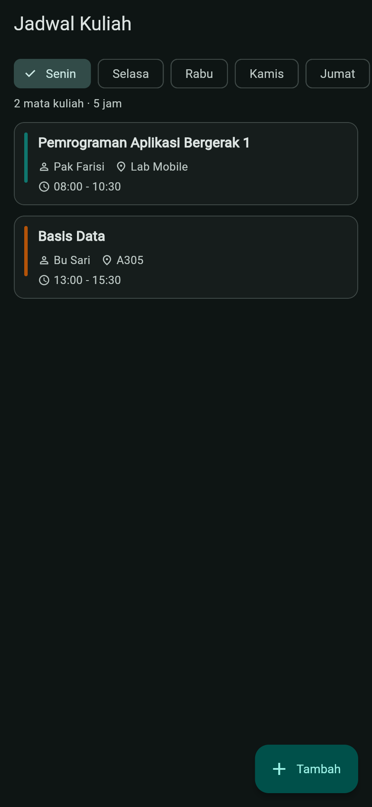
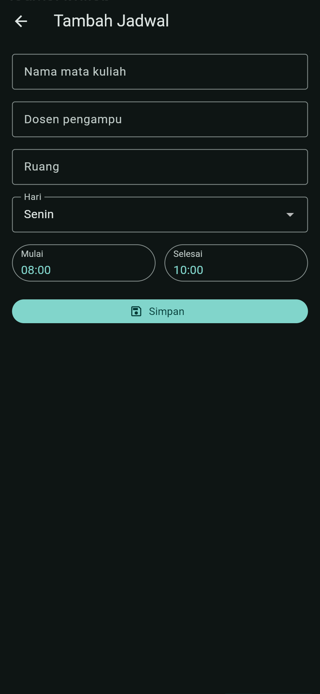
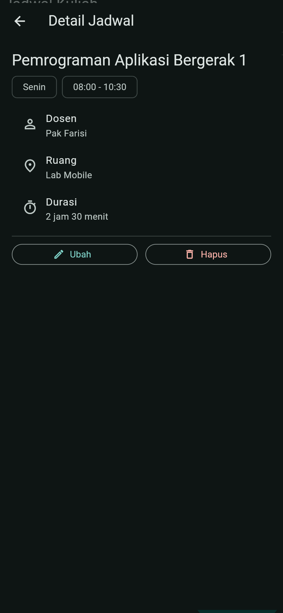
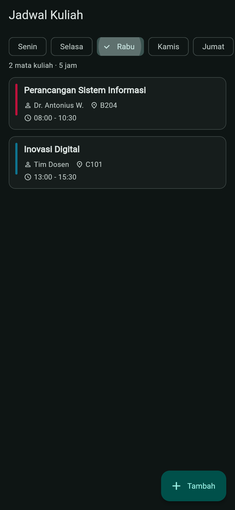

# Aplikasi Jadwal Kuliah

Aplikasi Flutter untuk melihat jadwal kuliah mingguan. Tugas kelompok mata kuliah Pengembangan Aplikasi Bergerak 1, dikerjakan mengikuti video tutorial kelas (<https://youtu.be/OA_uOh_s5aQ>).

## Demo

Versi web bisa dicoba di <https://jadwal-kuliah-fawn.vercel.app>. Halaman dibangun ulang otomatis setiap ada push ke branch `main`, memakai Flutter SDK yang di-clone saat proses build (lihat `vercel.json`).

## Fitur

- Melihat jadwal per hari — pilih hari di baris chip, daftar mata kuliah ikut berubah. Di atas daftar ada ringkasan jumlah mata kuliah dan total jam.
- Menambah jadwal — tombol Tambah membuka form. Nama mata kuliah wajib diisi dan jam selesai harus setelah jam mulai.
- Melihat detail — ketuk kartu jadwal untuk melihat dosen, ruang, dan durasi.
- Ubah dan hapus — tombol di layar detail. Hapus selalu minta konfirmasi dulu.

## Tangkapan layar

| Beranda | Tambah jadwal | Detail |
|---|---|---|
|  |  |  |

Ganti hari lewat chip, daftar ikut berubah (contoh: Rabu):



## Struktur proyek

```
lib/
├── main.dart                  — titik masuk aplikasi dan tema
├── models/jadwal.dart         — model Jadwal + bantuan format jam dan durasi
├── data/data_contoh.dart      — data contoh mata kuliah
├── screens/
│   ├── home_screen.dart       — layar utama: daftar jadwal + filter hari
│   ├── form_screen.dart       — form tambah/ubah jadwal
│   └── detail_screen.dart     — detail jadwal + aksi ubah/hapus
└── widgets/kartu_jadwal.dart  — kartu satu mata kuliah
```

## Widget yang dipakai

| Widget | Dipakai untuk |
|---|---|
| `Card` + `InkWell` | kartu jadwal yang bisa diketuk |
| `ChoiceChip` | memilih hari |
| `ListView` | daftar jadwal dan isi form |
| `FloatingActionButton.extended` | tombol Tambah |
| `Form` + `TextFormField` | input nama, dosen, dan ruang beserta validasi |
| `DropdownButtonFormField` | memilih hari di form |
| `showTimePicker` | memilih jam mulai dan selesai |
| `SnackBar` | notifikasi setelah simpan atau hapus |
| `AlertDialog` | konfirmasi sebelum menghapus |
| `Chip`, `ListTile`, `Divider` | tampilan layar detail |

## Menjalankan

Butuh Flutter SDK (dites dengan Flutter 3.47). Dari folder proyek:

```
flutter pub get
flutter run -d chrome
```

Pemeriksaan dan build web:

```
flutter analyze
flutter test
flutter build web --release
```

## Alur kerja GitHub

1. Branch `main` selalu berisi versi yang bisa jalan. Sebelum digabung, perubahan wajib lolos `flutter analyze` dan `flutter test`.
2. Anggota yang mengerjakan bagian tertentu membuat branch sendiri, misalnya `fitur-form`.
3. Perubahan masuk lewat pull request: satu orang mengajukan PR, anggota lain meninjau dan merge setelah dicek.

## Catatan

- Data jadwal masih disimpan di memori (belum pakai database), jadi perubahan kembali ke data contoh setiap aplikasi dibuka ulang.
- Pengujian dilakukan di Chrome. Build Android belum dicoba karena laptop pengembangan belum ada Android SDK; perintahnya sama, `flutter build apk`.
